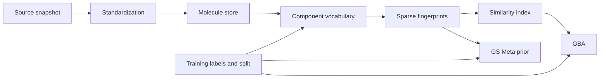

# Platform architecture

The core produces versioned molecule identities, component vocabularies, and sparse fingerprints. Retrieval feeds GBA; GS-Meta consumes structural features through an isolated adapter. Consumers do not redefine data identity.

| Module | Responsibility |
| --- | --- |
| ingestion | Snapshot inventory, downloads, checksums, bounded concurrency, resume |
| chemistry | Deterministic standardization, structure identity, fragment semantics |
| vocabulary | Component registry, structural fit, supervised selection, hybrid mapping |
| fingerprints | Immutable binary/count encoding, feature order, OOV statistics |
| storage | Versioned tables, manifests, staging and atomic completion |
| retrieval | Exact scoring, candidate indices, reranking, eligibility filters |
| prediction | GBA evidence, calibration, abstention |
| evaluation | Splits, label masks, leakage checks, metrics |
| integrations | Upstream compatibility and GS-Meta prior injection |

## Storage and environments

Start with a single-machine shard pipeline, Parquet tables, DuckDB analysis, and sparse rows/inverted postings. Dependencies are selected and locked during implementation. A hosted API or distributed engine is outside the first milestone.

Core Python >=3.10 and legacy GS-Meta Python 3.7 use separate environments. Exchange ordered molecule IDs, fingerprint/edge artifacts, manifests, and predictions. Avoid imports from mutable baseline paths. Use a pinned isolated upstream copy or an attributed port after license review.

## Scale gates

Plan roughly 10,000, then 100,000, then 1,000,000 molecules before larger snapshots. These are planning sizes, not measured capacity. Record counts, wall time, workers, peak RSS, disk bytes, build time, p50/p95 query latency, retrieval recall, and failure/OOV rates at each gate.

The illustrative 10-million by 1-million matrix requires 40 TB as float32 or 1.25 TB as packed bits before metadata. Sparse cost depends on measured nonzeros and posting overhead. Never materialize all molecule pairs.

## Deferred decisions

Final project license, dependency lock, concrete PubChem snapshot, standardization chemistry details, collaborator code availability, hardware budgets, and deployment topology are task deliverables or ADRs. Do not hide unresolved decisions behind defaults.
